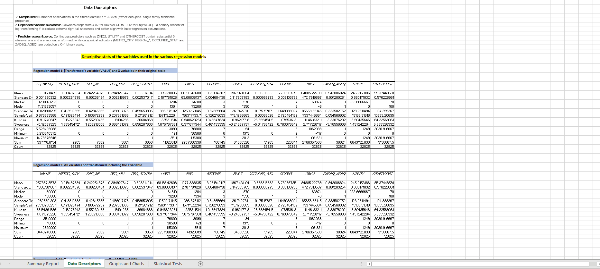
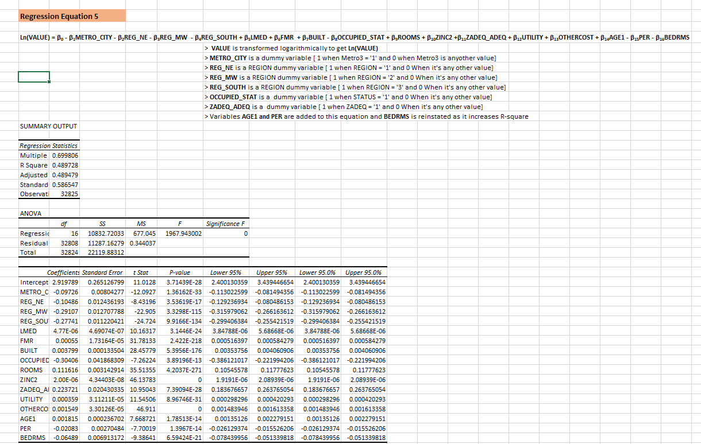

# Econometric Housing Valuation Model (2013 AHS/HADS)

## Project Overview
Multiple linear regression analysis in Excel examining factors associated with 2013 single-family housing market values (`VALUE`) using American Housing Survey / Housing Affordability Data System (AHS/HADS) data.

## Data Cleaning & Preparation
* Filtered to single-family housing units (`TYPE = 1`, `STRUCTURETYPE = 1`) with valid market values (`VALUE >= $1,000`).
* Excluded zero-variance fields (`OCCUPIED_STAT`) that caused division-by-zero errors (`#DIV/0!`) in correlation calculations.
* Applied a natural log transformation (`Ln(VALUE)`) to address right-skewness in raw property values and enable semi-log percentage interpretations ($100(e^{\beta} - 1)$).

## Model & Key Variables

* **Dependent Variable:** `Ln(VALUE)` (2013 property market value)
* **Property & Adequacy:** `BUILT`, `ROOMS`, `BEDRMS`, `ZADEQ_ADEQ` (1 = physically adequate)
* **Location & Market Benchmarks:** `METRO_CITY` (1 = central city), regional indicators (`REG_NE`, `REG_MW`, `REG_SOUTH`, with West as baseline), `LMED`, `FMR`
* **Household & Cost Factors:** `ZINC2`, `UTILITY`, `OTHERCOST`, `AGE1`, `PER`

## Key Takeaways
* Summarizes how structural features, household/cost variables, and local market benchmarks relate to residential property values in the cleaned 2013 sample.
* Demonstrates percentage-change interpretation for continuous predictors and baseline comparisons for binary indicators.
* The adjusted R-square value only explains 49% of the variation in single-family home values ,  the remaining unexplained variation comes from unmeasured property-specific features not captured in HADS/ this dataset (such as lot acreage, interior renovations, school district quality, and exact neighborhood).

## Files in This Repository
* [Linear Regression Equation Development](linear_regression_equation_development.xlsx) — Data cleaning, descriptive/correlation analysis, and regression output.